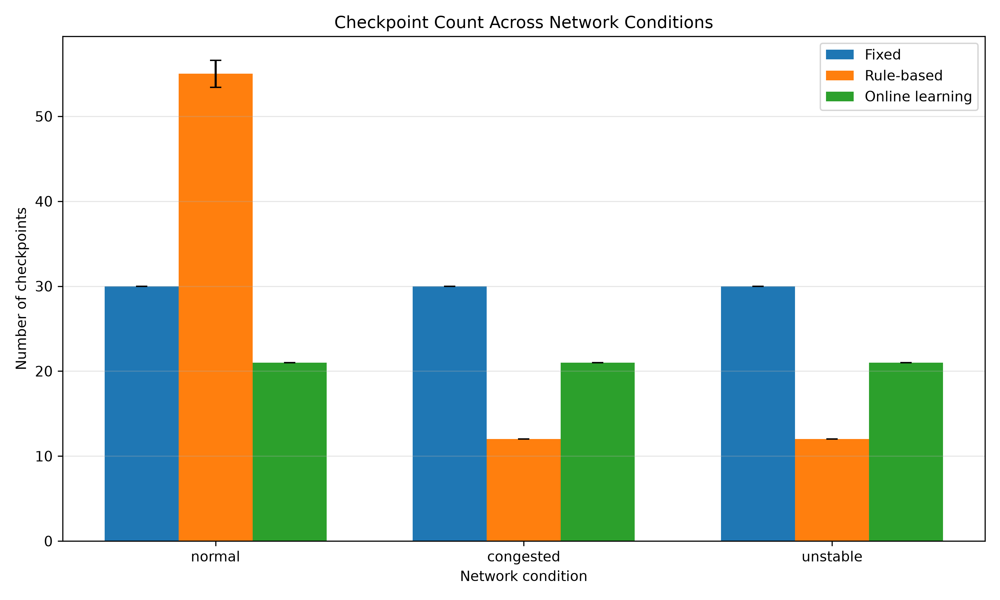
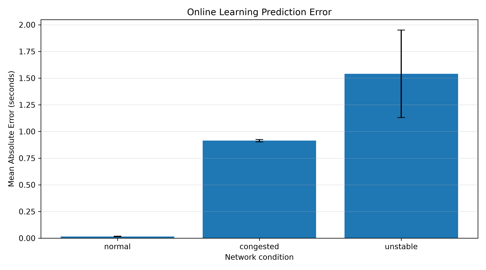

# Adaptive Checkpointing Using Online Learning

An experimental distributed-workload checkpointing system that compares
fixed-interval, rule-based, and online-learning-based checkpoint scheduling
under different network conditions.

## Overview

Checkpointing periodically saves application progress so that execution can
resume after a failure instead of restarting from the beginning.

This project implements a multi-worker checkpointing environment with:

- Multiprocessing-based worker execution.
- Periodic local checkpoint creation.
- Checkpoint recovery after worker failure.
- TCP-based checkpoint transfer.
- SHA-256 integrity measurement.
- Network-condition emulation.
- Fixed, rule-based, and online-learning checkpoint strategies.
- Runtime metrics and CSV-based experiment logging.

The online-learning strategy uses an incremental regression model to predict
checkpoint transfer time. Its controller uses the prediction and estimated
computation rate to select a subsequent checkpoint interval.

## Project Highlights

- **3 checkpointing strategies:** Fixed, rule-based, and online-learning-based.
- **3 network conditions:** Normal, congested, and unstable.
- **45 benchmark experiments:** 3 strategies × 3 network conditions × 5 trials.
- **1,128 successful checkpoint transfers** recorded across the experiments.
- **Fault recovery:** Workers can resume computation from their latest saved checkpoint.
- **Performance analysis:** Execution time, checkpoint frequency, transfer performance, and online prediction error.

## Installation and Setup

### Prerequisites

- Python 3.10 or later
- Ubuntu Linux or WSL2
- Git
- Linux networking utilities (`iproute2` and `tc`)
- Root privileges for network namespace configuration

### 1. Clone the Repository

```bash
git clone https://github.com/imTaha76/adaptive-checkpointing-online-learning.git
cd adaptive-checkpointing-online-learning
```

### 2. Create a Virtual Environment

```bash
python3 -m venv .venv
source .venv/bin/activate
```

### 3. Install Dependencies

```bash
pip install --upgrade pip
pip install -r requirements.txt
```

### 4. Verify the Installation

```bash
python3 -m py_compile src/*.py
```

### 5. View Available Options

```bash
python3 src/main.py --help
```

### 6. Run the Checkpointing System

**Fixed checkpointing:**

```bash
python3 src/main.py --reset --strategy fixed --checkpoint-interval 200000 --payload-mb 1
```

**Rule-based checkpointing:**

```bash
python3 src/main.py --reset --strategy rule-based --checkpoint-interval 200000 --payload-mb 1
```

**Online-learning-based checkpointing:**

```bash
python3 src/main.py --reset --strategy online-learning --checkpoint-interval 200000 --payload-mb 1
```

### 7. Simulate Worker Failure and Recovery

```bash
python3 src/main.py --reset --strategy online-learning --checkpoint-interval 200000 --payload-mb 1 --crash-worker 2 --crash-after 450000
```

This simulates a worker failure and demonstrates recovery from the most recent saved checkpoint.

### Network Experiment Setup

The network experiments use Linux network namespaces and traffic control (`tc netem`) to simulate different network conditions.

The receiver server must be running in the receiver namespace before starting networked experiments.

**Note:** The commands above demonstrate the main application strategies. Full network benchmarking requires the receiver server and network namespace configuration to be set up separately.


## System Architecture

```text
                 Main Process
                      |
          +-----------+-----------+
          |           |           |
       Worker 1    Worker 2    Worker 3
          |           |           |
          +-----------+-----------+
                      |
              Checkpoint Manager
                      |
             Local Checkpoint
                Persistence
                      |
               TCP Transfer
                      |
              Receiver Server
                      |
             Transfer Logging
                      |
          Online Learning Controller
                      |
           Adaptive Interval Selection
                      |
              Worker Execution
```

The system runs multiple workers concurrently, periodically saves their progress, transfers checkpoint payloads over TCP, and uses observed performance data to inform future checkpoint intervals.

## Benchmark Results

The system was evaluated across three simulated network conditions using three checkpointing strategies, with five trials per combination.

**Total experiments:** 45 (3 network conditions × 3 strategies × 5 trials)

### Average Execution Time

| Network Condition | Fixed | Rule-Based | Online Learning |
|---|---:|---:|---:|
| Normal | 14.21 s | **15.46 s** | 16.58 s |
| Congested | 36.17 s | **22.52 s** | 29.23 s |
| Unstable | 60.47 s | **29.56 s** | 45.31 s |

### Average Checkpoint Count

| Network Condition | Fixed | Rule-Based | Online Learning |
|---|---:|---:|---:|
| Normal | 30 | 48.6 | 21 |
| Congested | 30 | 12 | 21 |
| Unstable | 30 | 12 | 21 |

### Online Learning Prediction Error

| Network Condition | Mean Absolute Error (MAE) |
|---|---:|
| Normal | 0.0180 s |
| Congested | 1.6608 s |
| Unstable | 3.0716 s |

### Transfer Reliability

- **1,128 checkpoint transfers** recorded.
- **100% transfer success** across the evaluated experiments.
- No failed transfers were recorded in the final benchmark batch.

## Key Experimental Findings

The benchmark results show that checkpoint scheduling performance depends on network conditions.

- **Normal network:** Fixed scheduling achieved the lowest average execution time (14.21 seconds).
- **Congested network:** Rule-based scheduling achieved the lowest average execution time (22.52 seconds).
- **Unstable network:** Rule-based scheduling achieved the lowest average execution time (29.56 seconds).
- **Online learning:** Reduced the average checkpoint count from 30 (fixed strategy) to 21 across all three network profiles.

### Interpretation

The online-learning controller successfully uses incremental model predictions to inform checkpoint interval selection. However, it did not achieve the lowest execution time in these experiments. This highlights the importance of improving the scheduling objective and adapting it more effectively to changing network conditions.

These findings are based on 45 benchmark runs across three simulated network profiles.

## Performance Visualizations

### Execution Time Comparison


### Checkpoint Count Comparison


### Online Learning Prediction Accuracy

