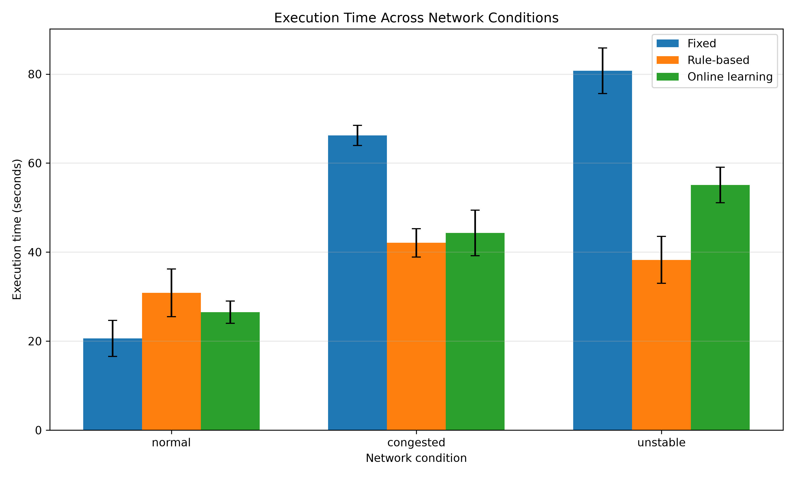

# Adaptive Checkpointing Using Online Learning

An experimental distributed-workload checkpointing system that compares
fixed-interval, rule-based, and online-learning-based checkpoint scheduling
under different network conditions.

## Overview

Checkpointing periodically saves application progress so that execution can
resume after a failure instead of restarting from the beginning.

This project implements a multi-worker checkpointing environment with:

- Multiprocessing-based worker execution.
- Periodic local checkpoint creation.
- Checkpoint recovery after worker failure.
- TCP-based checkpoint transfer.
- SHA-256 integrity measurement.
- Network-condition emulation.
- Fixed, rule-based, and online-learning checkpoint strategies.
- Runtime metrics and CSV-based experiment logging.

The online-learning strategy uses an incremental regression model to predict
checkpoint transfer time. Its controller uses the prediction and estimated
computation rate to select a subsequent checkpoint interval.

## Project Highlights

- **3 checkpointing strategies:** Fixed, rule-based, and online-learning-based.
- **3 network conditions:** Normal, congested, and unstable.
- **45 benchmark experiments:** 3 strategies × 3 network conditions × 5 trials.
- **1,128 successful checkpoint transfers** recorded across the experiments.
- **Fault recovery:** Workers can resume computation from their latest saved checkpoint.
- **Performance analysis:** Execution time, checkpoint frequency, transfer performance, and online prediction error.

## Architecture

                 Experiment Coordinator
                          |
             +------------+------------+
             |            |            |
          Worker 1     Worker 2     Worker 3
             |            |            |
             +------------+------------+
                          |
                  Checkpoint Manager
                          |
                  Local Checkpoint
                          |
                   TCP Transfer
                          |
                  Receiver Process
                          |
                 Transfer Measurement
                          |
              Strategy / Online Learning
                          |
                Next Checkpoint Interval

## Performance Visualizations

### Execution Time Comparison

### Checkpoint Count Comparison

### Online Learning Prediction Accuracy

